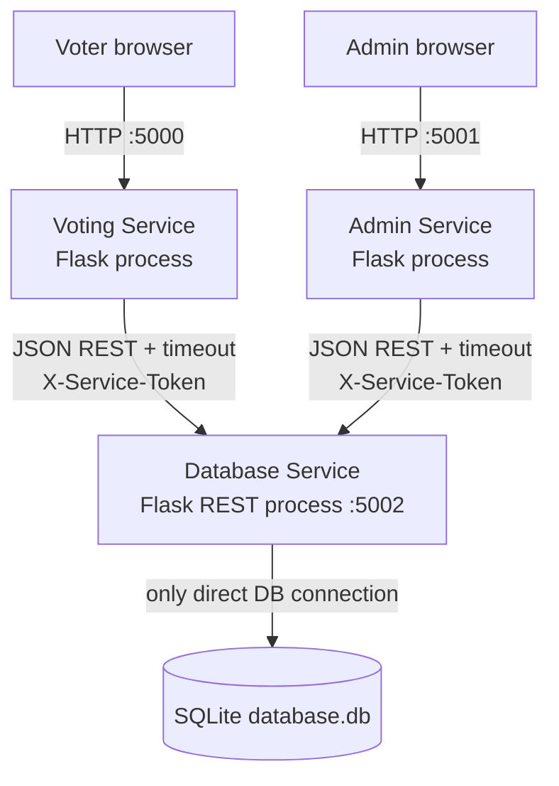

# Distributed Online Voting System

This is **a distributed system simulation implemented using multiple independent services running as separate processes on a single computer**. It does not claim to be a physically distributed, multi-machine deployment.

The system adapts the existing Online Voting System. Its Flask routes, AdminLTE-based pages, assets, six-table data model, authentication, voter profiles, elections, positions, candidates, ballots, votes, results, and vote reset behavior were retained where practical. The original project is preserved unchanged in `Original_Project_Backup/voting_system_python`; the distributed version is separate.

## Architecture



| Service | Entry point | Port | Responsibility |
|---|---|---:|---|
| Voting | `Voting_Service/app.py` | 5000 | Voter login/registration, profile, elections, ballot and submission |
| Voting replica 2 | `Voting_Service_2/app.py` | 5005 | Second independent voter-facing process using the same REST API |
| Admin | `Admin_Service/admin.py` | 5001 | Admin login, voter/candidate/position/election management, vote list, results/dashboard |
| Database | `Database_Service/database_api.py` | 5002 | Authentication data, validation, transactions, all SQLite access, results |

Voting and Admin know only the Database Service base URL and JSON contract. They do not import `sqlite3`, run SQL, or open the database. The Database Service uses an atomic `BEGIN IMMEDIATE` transaction and a unique index when accepting a ballot, preventing duplicate choices during concurrent requests.

## Request/response flows

Voter submission:

1. Browser posts a ballot to Voting Service (`POST /submit_ballot`).
2. Voting Service converts the unchanged HTML form fields into a JSON selection map.
3. It sends `POST http://127.0.0.1:5002/api/votes` with the service token.
4. Database Service validates the election deadline, position ownership, candidate ownership, maximum votes, and previous choices in one transaction.
5. Database Service stores the vote and returns JSON; Voting Service shows the existing success/error flash message.

Admin results:

1. Browser opens Admin Service dashboard (`GET /admin/home`).
2. Admin Service requests `GET /api/dashboard?election_id=...`.
3. Database Service runs aggregate queries and returns counts, candidates, totals, winners, and ties as JSON.
4. Admin Service renders the existing dashboard page.

## REST API

All endpoints except `/api/health` require `X-Service-Token`. The demonstration default is `university-demo-token`; set the same `SERVICE_TOKEN` environment variable in all three terminals for a different value.

| Method | Endpoint | Purpose |
|---|---|---|
| GET | `/api/health` | Service/database health |
| POST | `/api/media` | Upload shared candidate image media |
| GET | `/media/{filename}` | Serve candidate media to voter/admin browsers |
| POST | `/api/auth/voter` | Authenticate voter |
| POST | `/api/auth/admin` | Authenticate admin |
| GET/POST | `/api/voters` | List/create voters |
| POST | `/api/voters/register` | Self-register voter |
| GET/PUT/DELETE | `/api/voters/{id}` | Voter detail/update/delete |
| GET/POST | `/api/elections` | List/create elections |
| DELETE | `/api/elections/{id}` | Delete election and dependent data |
| GET/POST | `/api/positions` | List/create positions; optional `election_id` query |
| GET/PUT/DELETE | `/api/positions/{id}` | Position CRUD |
| POST | `/api/positions/{id}/move` | Move ballot position up/down |
| GET/POST | `/api/candidates` | List/create candidates; optional election filter |
| GET/PUT/DELETE | `/api/candidates/{id}` | Candidate CRUD |
| GET | `/api/ballot?voter_id={id}` | Elections, positions, candidates, prior selections and closed results |
| POST | `/api/votes` | Validate and atomically submit choices |
| GET/DELETE | `/api/votes` | List/reset votes; optional election filter |
| GET | `/api/results?election_id={id}` | Result totals, winner and tie information |
| GET | `/api/dashboard?election_id={id}` | Admin counts and results |
| GET | `/api/admin/{id}` | Safe admin profile (password omitted) |

Typical vote JSON:

```json
{
  "voter_id": 4,
  "election_id": 1,
  "selections": {"1": ["2"], "3": ["7", "8"]}
}
```

## Installation (Windows, no Docker or cloud)

From this directory:

```powershell
py -m venv .venv
.\.venv\Scripts\Activate.ps1
python -m pip install -r requirements.txt
```

The distributed database starts as a copy of the existing `voting.db`, preserving its tables and records. The untouched backup has its own database reference copy.

## Run as three independent processes

Open three CMD/PowerShell windows in this directory:

```powershell
python Database_Service/database_api.py
```

```powershell
python Voting_Service/app.py
```

```powershell
python Admin_Service/admin.py
```

For the optional second voter portal, open a fourth terminal:

```powershell
python Voting_Service_2/app.py
```

Open [http://127.0.0.1:5000](http://127.0.0.1:5000) for Voter Portal 1, [http://127.0.0.1:5005](http://127.0.0.1:5005) for Voter Portal 2, and [http://127.0.0.1:5001/admin/](http://127.0.0.1:5001/admin/) for administrators. Both voter portals display the same elections and candidates and communicate with the same Database Service. They are separate processes but do not connect directly to SQLite. The preserved default admin, if the original database did not already contain one, is `admin` / `admin123`.

The two voter portals deliberately use different browser cookie names (`voting_session_5000` and `voting_session_5005`). Cookies are normally shared by hostname regardless of port, so these distinct names allow two different voters to remain logged in simultaneously in different tabs of the same browser.

Optional environment settings: `DATABASE_SERVICE_URL`, `SERVICE_TOKEN`, `VOTING_SECRET_KEY`, `ADMIN_SECRET_KEY`, and `VOTING_DB_PATH`.

## Testing

Run the automated structural and API tests while the Database Service is stopped (the suite starts an isolated one itself):

```powershell
python -m unittest discover -s tests -v
```

Manual demo:

1. Start all three services and check `/api/health`.
2. Register/login at port 5000 and submit a vote.
3. Login at port 5001, view the vote and dashboard, and add/edit a candidate.
4. Stop only Database Service. Refresh either UI: it stays alive and displays `Database Service is currently unavailable. Please try again later.`
5. Restart Database Service. Refresh again; both UI services recover without restart because they are loosely coupled HTTP clients.

## Why this demonstrates distributed-system concepts

- **Service separation / responsibility:** browser-facing concerns and data ownership are separate processes.
- **REST service-to-service communication:** operations cross a network interface even on localhost.
- **Database abstraction:** one service exclusively owns persistence and business-critical ballot validation.
- **Loose coupling:** the UI services depend on a URL/JSON contract, not SQLite or its schema queries.
- **Independent failure:** stopping the database process does not terminate either UI process; bounded timeouts produce a useful message.
- **Independent execution:** each Flask application has its own entry point, memory, session state, and port.

Running on localhost simulates distribution. The same HTTP boundary could later be assigned to separate machines, but this university demo intentionally runs on one Windows PC.

## Preservation evidence

No source file under `voting_system_last/voting_system_python` was modified. Before adaptation it was copied to `Original_Project_Backup/voting_system_python`. At copy time, the source and backup `app.py` SHA-256 values were both `046D505A5231C8655F5029A6F241125FA7B785C6C2143D5DEB34F378C4174318`.
